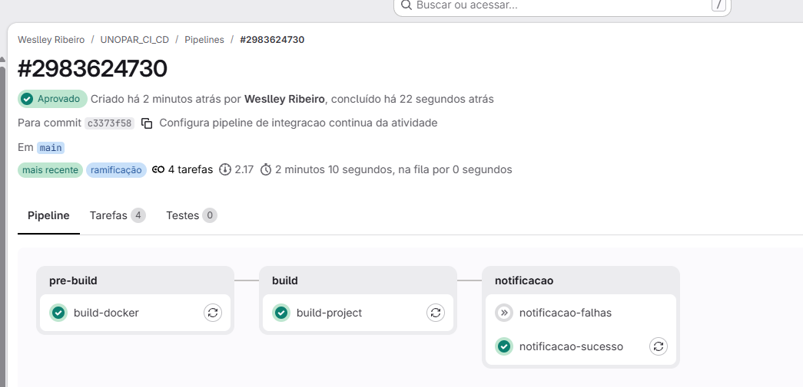
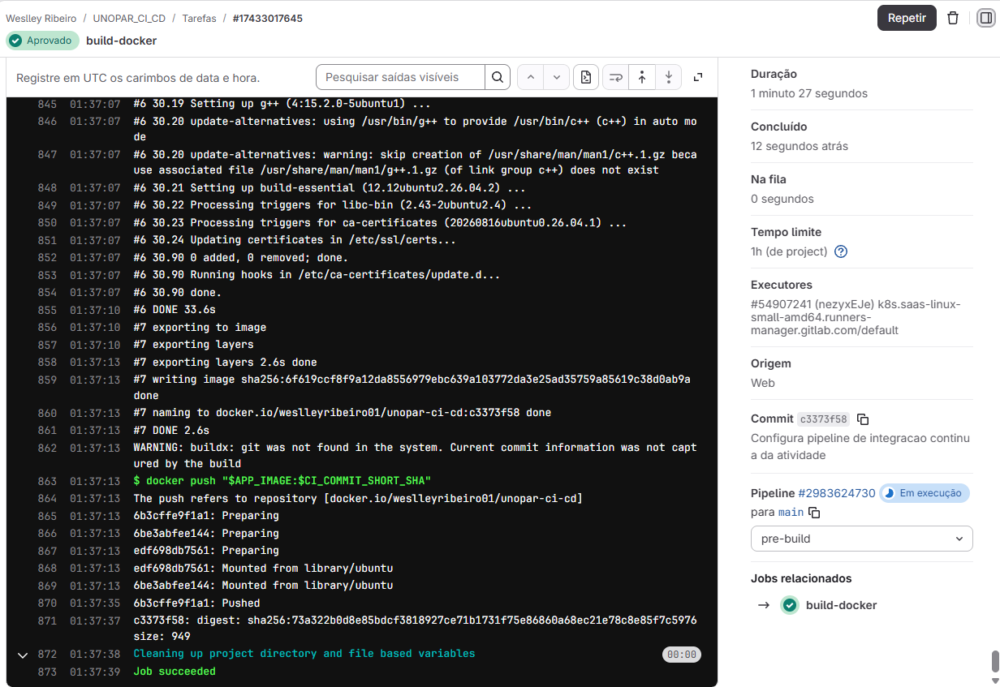
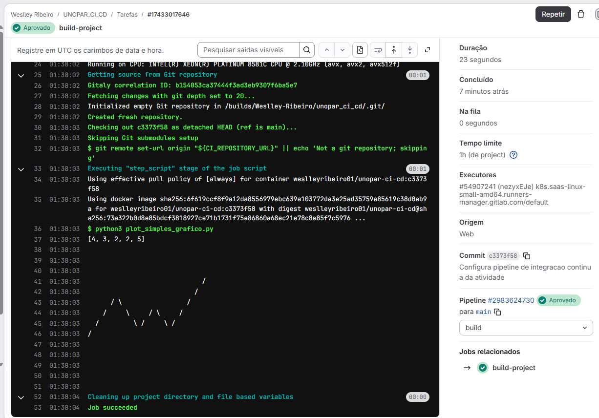

# GitLab CI/CD & Docker — Pipeline de Integração Contínua

<div align="center">


</div>

Laboratório prático de Infraestrutura Ágil e DevOps desenvolvido por Weslley Ribeiro. Automatiza a construção e publicação de uma imagem no Docker Hub, a execução de rotinas em Python e o envio de notificações condicionais via Shell Script a partir do GitLab CI/CD.

---

## 📌 Resultado da Pipeline

A esteira de integração contínua (Pipeline #2983624730) foi homologada e aprovada com sucesso no GitLab com a publicação da imagem `weslleyribeiro01/unopar-ci-cd:c3373f58` no Docker Hub.

| Etapa | Job / Trabalho | Duração | Status |
| :--- | :--- | :--- | :--- |
| **pre-build** | `construir-docker` | 1 min 27 s | Aprovado |
| **build** | `projeto-de-construcao` | 23 s | Aprovado |
| **notificacao** | `notificacao-sucesso` | 19 s | Aprovado |
| **notificacao** | `notificacao-falhas` | - | Ignorado (`on_failure`) |

---

## ⚙️ Arquitetura do Fluxo CI/CD

```text
    GitLab Repository (main)
               |
               v
    [Stage: pre-build]  --->  Docker Build & Login  --->  Docker Hub Registry (:c3373f58)
               |
               v
    [Stage: build]      --->  Pull da Imagem        --->  Execução do Script Python (Gráfico no log)
               |
               v
    [Stage: notificacao]--->  Validação de Status   --->  Execução de notificacaoSucesso.sh
```

---

## 📸 Evidências de Execução Prática

Abaixo estão os registros visuais de validação das etapas da pipeline e dos artefatos gerados:

<div align="center">
  <h3>1. Pipeline Concluído com Sucesso no GitLab</h3>
  
  <p><em>Execução das etapas com sucesso na esteira do GitLab CI/CD.</em></p>

  <br />

  <h3>2. Construção e Publicação da Imagem Docker</h3>
  
  <p><em>Build da imagem imutável e envio para o registro do Docker Hub.</em></p>

  <br />

  <h3>3. Execução do Projeto Python</h3>
  
  <p><em>Execução dos scripts e validação da lógica no ambiente de contêiner.</em></p>

  <br />

  <h3>4. Notificação de Sucesso</h3>
  
  <p><em>Disparo automatizado do script de notificação de sucesso via Shell.</em></p>
</div>

---

## 📂 Estrutura de Arquivos

* `.gitlab-ci.yml`: Definição declarativa da pipeline com Docker-in-Docker (dind) e TLS.
* `Dockerfile`: Configuração de ambiente base Ubuntu com Python 3 e pip.
* `plot_simples_grafico.py`: Programa em Python para plotagem de matriz e gráfico em caracteres no log.
* `relogio.py`: Script para captura e exibição de data e hora do ambiente de execução.
* `notificacaoSucesso.sh` / `notificacaoFalha.sh`: Scripts em Shell para mensagens condicionais de término.
* `requisitos.txt`: Declaração de dependências do ambiente.
* `LICENSE`: Licença MIT de uso livre do projeto.

---

## 💻 Execução Local

### Via Python nativo:
```bash
python3 plot_simples_grafico.py
python3 relogio.py
sh notificacaoSucesso.sh
```

### Via Docker:
```bash
# Construção local da imagem
docker build -t unopar-ci-cd:local .

# Execução do container montando o volume de trabalho
docker run --rm -v "$PWD:/workspace" -w /workspace unopar-ci-cd:local python3 plot_simples_grafico.py
```

---

## 🔗 Links e Rastreabilidade

* [Projeto Original no GitLab](https://gitlab.com/weslleyribeiro01/portfolio-infraestrutura-agil)
* [Job: Construir Docker](https://gitlab.com/weslleyribeiro01/portfolio-infraestrutura-agil/-/jobs/2983624730)
* [Documentação Oficial do GitLab CI](https://docs.gitlab.com/ci/)
* [Documentação do Dockerfile](https://docs.docker.com/get-started/docker-concepts/building-images/writing-a-dockerfile/)
